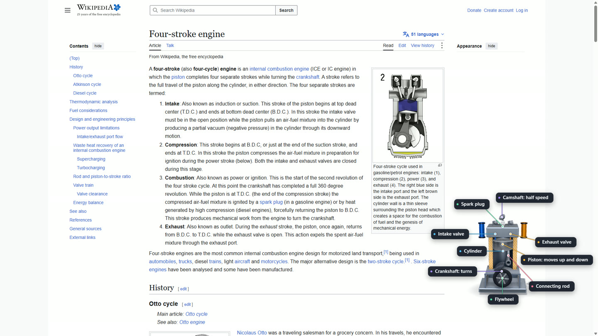
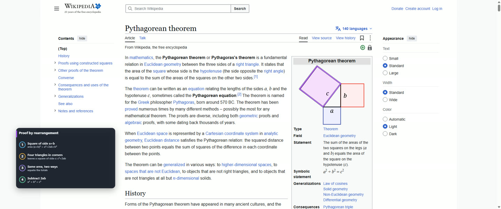

# Talkthrough

**An AI that talks you through anything on your screen, and draws as it talks.**

Hold a key and ask out loud. Talkthrough looks at your screen, points at what matters, draws diagrams and 3D models right over the page, and walks you through it step by step.


*A hand-written example scene (no model): how a pin tumbler lock opens. Live answers are drawn the same way, over whatever is on your screen.*

- **Works in any app or website:** no tutorial in another window.
- **Open source (MIT).** You choose how it runs your model (see [Choose how it runs your model](#choose-how-it-runs-your-model)).
- **Private:** in normal use Talkthrough itself writes nothing about your screen or questions to disk (saving an answer to come back to is planned).
- **Safe:** it draws, it never runs generated code.

> **Status: pre-release, Windows first.** The whole loop runs: hotkey, microphone, screen capture, a model through your own Codex or Claude Code install, the scene language and the three.js overlay, including guided walks that wait for your click. It needs a local speech recogniser you point it at (see [setup](docs/setup.md)). See [Status](#status) for exactly what exists today.

## What it can show

Everything below is drawn by the overlay from a small JSON scene a model writes. The pictures are frames of real answers (or, where it says so, of hand-written example scenes) replayed over the pages they were asked about.

- **Marks on the page.** Boxes, circles, underlines, arrows and labels for text and regions. For something *inside* a picture (a figure, a graph, a map) it can put an outline round a tilted or irregular shape, a point on one exact spot, or a line along a curve. The overlay then nudges a mark onto the page's own lines and corners when it is a few percent off, and leaves it alone when it cannot tell what was meant.
- **Flat diagrams.** A **flow** for a process, a **timeline** for events, **steps** for a how-to and a **chart** for how two things relate. You never place the parts: they are laid out for you, drawn on as the voice reaches them, and placed where there is room, in a margin or beside a column when the page has one.
- **3D models.** Built part by part in view, from a kit of ready-made parts (pistons, valves, gears, housings, chips and more) or from shapes. They can run (a crankshaft turns, valves open on their cams, a spark flashes), be cut open to show the inside, and be pulled apart. You can turn one with the mouse, and press **E** to open it up.
- **Soft, organic forms.** Shapes like a heart or a plant are built as blended lumps with tapering tubes for vessels and stems, not as boxes (the samples include a heart and a plant).
- **Guide mode.** For "how do I do this in that app", the answer becomes a walk: it marks where to click, waits for your click, checks the screen really changed, and shows the next step. A checklist of the moves ticks along. It never clicks for you.
- **More detail.** If you set up a second, stronger model, a **More detail** button rebuilds what is on screen in much finer detail.







*Frames from live answers replayed over the pages they were asked about; in the guide frame the checklist is hand-written.*

See [the scene language](docs/scene-language.md) for everything a model may draw and [the overlay notes](docs/overlay.md) for how it is drawn.

## Contribute

Talkthrough is built from small, self-contained pieces, and each is a good first contribution:

- **Model adapters:** connect another vision model (hosted or local).
- **Voice adapters:** another text-to-speech voice.
- **Speech adapters:** another way to turn your spoken question into text.
- **Scene primitives:** new things the model can draw.
- **Mac and Linux:** the overlay, hotkey and capture layers.

Start with [CONTRIBUTING.md](CONTRIBUTING.md) (how to run and test it, the seams, and the one rule: a model draws, it never runs code), then `src/adapters/` (the interfaces are a few lines each) and `docs/scene-language.md`.

## Install

Download `Talkthrough-Setup-<version>.exe` from the [releases page](https://github.com/ProjectIdris/talkthrough/releases) and run it. It installs for your own account only (no administrator rights) and starts from the Start menu. You still need a way to hear you and a model: see [docs/setup.md](docs/setup.md).

**Windows may warn you.** The first releases are not code-signed, because a signing certificate costs money and the project is new, free and open source. Windows SmartScreen therefore shows *"Windows protected your PC"* with *Unknown publisher* for a file it has not seen many times. This does not mean the file is bad; it means Windows does not know it yet. To go on, choose **More info**, then **Run anyway**. If you would rather not, you can build the installer yourself from this repository (`npm ci`, then `npm run dist`; see [docs/setup.md](docs/setup.md)) and read every line first.

## Quick start

Requires Windows and Node.js 24 or newer.

```
npm install
npm test            # runs the tests
npm run typecheck   # tsc --noEmit
```

`npm start` runs the app; see [docs/setup.md](docs/setup.md) for the settings, the model and speech.

## Choose how it runs your model

Talkthrough sends your screenshot and question to a model you choose. Pick one in [settings](docs/setup.md):

1. **Your own locally installed Codex CLI**, signed in by you.
2. **Your own Claude Code**, signed in by you.
3. **An API key** (OpenAI), entered from the tray menu and stored encrypted for your Windows account.

Talkthrough starts the tool you already have and gives it no tools of its own: it can only answer. It never reads or stores your sign-in. Check your provider's terms for automated use before you pick one.

## How it works

```
 hold Right Ctrl + Right Shift
            |
   +--------v---------+     +------------------+
   | hotkey + mic     |---->| screen capture   |  (in memory only)
   +--------+---------+     +--------+---------+
            | your question          | screenshot
            v                        v
        speech-to-text  --->  vision model  --->  scene language (JSON steps)
                                                        |
                              validator: drops anything unknown, clamps numbers
                                                        |
                         +------------------------------+----------------+
                         v                                               v
              overlay (three.js): marks on             voice: speaks each step,
              your screen + 3D models over the page    the drawing starts with the words
```

1. **Hotkey.** Hold Right Ctrl + Right Shift; holding records your question, letting go sends it.
2. **Capture.** The screen under the pointer is captured and kept in memory only. While you hold the keys you can also drag the mouse to circle something: your stroke is drawn on the screenshot and a closer crop around it goes along, so "what is this?" means what you circled.
3. **Model.** A vision model gets the screenshot, your question and the earlier turns of the thread, and answers in the **scene language**: timed steps, each with something to say and things to draw. The model can also say a question is beyond it.
4. **Scene language.** A small JSON format (boxes, ovals, arrows, labels, and 3D shapes with tweens and camera moves). It is data, validated before anything is drawn; no code is ever run. See [docs/scene-language.md](docs/scene-language.md).
5. **Renderer.** A transparent, click-through overlay draws marks over your screen and 3D models over the page with [three.js](https://threejs.org). A framed 3D panel is optional.
6. **Voice.** Each step is spoken as it arrives; the default is your system voice.

Models, voices, speech recognition and backends are adapters in `src/adapters/`, so you can plug in your own. A question that is beyond the fast model can go to a **deeper backend** you point the app at (a plain HTTP address; see [docs/backend.md](docs/backend.md)): click the offer, or say "ask the backend".

## Status

| | |
| --- | --- |
| Scene language, validator, streaming parser, JSON Schema | working, tested |
| Model, voice, speech-to-text and backend interfaces; system voice; local speech-server client | working, tested |
| Overlay window, hotkey, screen capture, microphone, tray | working |
| Models through your own Codex or Claude install, locked down to no tools | working, tested against stand-ins |
| A speech recogniser that ships with the app | planned (today: a local server you point it at) |
| Flat diagrams (flow, timeline, steps, chart), laid out, drawn on with the voice and placed in free space | working; a live model drew one on six of eight real pages tried |
| New mark shapes (outline, point, trace) and snapping marks onto the page's lines | working; replayed on eight saved pages, and live answers used the outline and the point |
| 3D models from a parts kit, running machines, cut-open and pulled-apart views, organic forms | working; seen in frames of hand-written samples and a live engine answer |
| Guide mode: a walk that waits for your click, with a checklist | working, tested with stand-ins and replayed in frames; the click watch is not yet tried on a real desktop |
| The detail pass: a stronger model rebuilds what is on screen in more detail | working; run live once on a real article |
| Circle something with the mouse while the keys are held: the model sees your stroke and a closer crop | working, tested with a stand-in stroke; the drag itself not yet tried by hand |
| Model through an OpenAI API key | working, tested against a fake server (not yet run against the live service) |
| A deeper backend over HTTP, by the offer or by voice, answering in the scene language | working, tested against a fake server; the contract is in docs/backend.md |
| Pinning an answer (tray, or say "pin this"): its question, the conversation and the scene saved to a local folder | working, tested |
| Mac and Linux | planned |

Windows is the first platform.

## Privacy

- **What leaves the app:** your screenshot and the text of your question go to the model you chose (see above), and your recording goes to the speech server whose address you set (meant to be on your own machine; none is built in). If you set a backend address, a question you hand to it also goes there with its screenshot, the earlier questions and what is on screen. Nothing else.
- **What Talkthrough keeps:** the screenshot and your recording live in memory only and are not written to disk in normal use (the development options `--save-capture`, `--save-pen` and `--frames-dir` save images). Your latest questions and answers stay in memory so a follow-up question works; they are gone when you quit. The one thing that is written to disk is an answer you pin (tray, or say "pin this"): its question, what was said and the scene go to a folder on your machine ([docs/pins.md](docs/pins.md)), and the screenshot only if you tick "Include the screenshot in pins". Nothing else is kept. The model tool you choose has its own policies.
- **While a guided task runs**, a short list of what happened so far is kept in memory only, and gone when the guide ends.

## Layout

```
src/main/       Electron main process: windows, hotkey, capture, microphone, the question loop
src/overlay/    the overlay renderer (three.js)
src/scene/      the scene language: types, validator, step stream, JSON Schema
src/adapters/   Model, Voice, SpeechToText and Backend interfaces and defaults
test/           node:test tests
scripts/        build and tooling
docs/           setup, the scene language specification, the overlay
samples/        hand-written example scenes
```

TypeScript is written in its erasable subset (no enums or namespaces) and imported with `.ts` extensions, so tests run directly on Node's built-in type stripping.

## Licence

MIT. See [LICENSE](LICENSE). Copyright (c) 2026 Talkthrough contributors.
