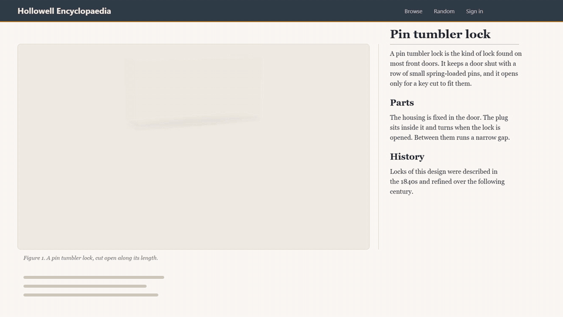
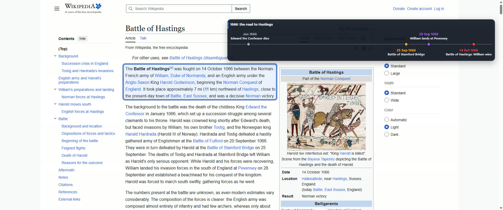
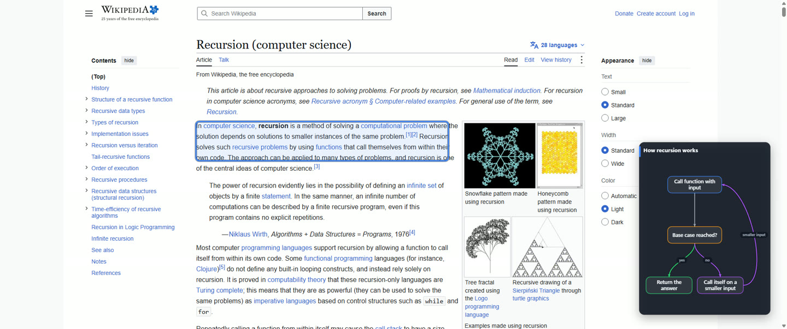
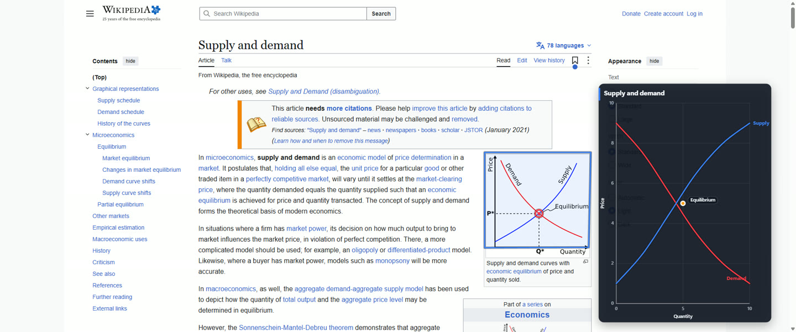
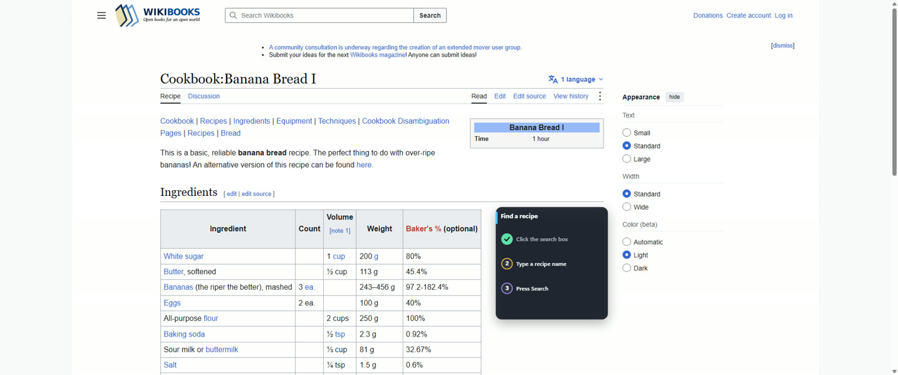

# Talkthrough

**Ask about what is on your screen. Get a spoken or written explanation with marks, diagrams, or a 3D model over the page.**

[Download the latest stable Windows installer](https://github.com/ProjectIdris/talkthrough/releases/latest) | [Setup and first run](docs/setup.md) | [Experimental branch](https://github.com/ProjectIdris/talkthrough/tree/experimental)

Hold **Right Ctrl + Right Shift**, ask your question, then release. The picture and explanation appear over the app you were using. You can choose another hotkey in Settings.



*This is a hand-written demonstration scene, not an answer generated by a model. It shows the renderer animating the lock mechanism in stages; generated answers can vary in detail and quality.*

## What it can do

- **Explain what you point to.** Draw boxes, circles, underlines, arrows, labels, and outlines on text, pictures, and diagrams. Drag to circle an area before sending a question. Press **Escape** to cancel a question or stop an answer.
- **Draw diagrams as it explains.** Flows, timelines, steps, and charts are placed and revealed with the answer. Guide mode marks where to click, waits for you, checks that the screen changed, and uses a checklist. Optional limited guide navigation is off by default.
- **Show moving 3D parts.** Models appear directly over the page by default; a frame is optional. Joints, loops, and couplings connect moving parts. Ropes, belts, wires, and pipes can carry moving markers or diagram arrows. You can turn a model with the mouse; **E** opens it up.
- **Ask a follow-up.** Choose **Ask more** while an explanation is visible. The next question can continue from the same picture. **More detail** is a separate optional pass that rebuilds the scene in greater detail when configured.
- **Choose voice, text, or both.** Captions can speak each step and show its words, show text only, or speak without captions.

## Examples

These are saved answer frames from pages used as examples. The first animation above is a separate hand-written scene. Page content shown here comes from Wikipedia or Wikibooks and is available under CC BY-SA 4.0.

<table>
  <tr>
    <td><br><strong>Timeline</strong> - events are placed along a shared time axis.</td>
    <td><br><strong>Flow</strong> - a branching explanation shows the base case and the recursive call.</td>
  </tr>
  <tr>
    <td><br><strong>Chart</strong> - axes, curves, and an equilibrium point.</td>
    <td><br><strong>Guide</strong> - a checklist advances as you complete each step.</td>
  </tr>
</table>

## Get started

1. [Download the latest stable Windows installer](https://github.com/ProjectIdris/talkthrough/releases/latest) and run it. It installs for your Windows account and adds Talkthrough to the Start menu.
2. Open Talkthrough and choose a model connector. See [Setup](docs/setup.md) for model, speech, caption, privacy, and question-record settings.
3. Hold the hotkey, ask about the screen, and release. Use **Ask more** to continue while the explanation remains visible.

Windows may show a SmartScreen warning because the installer is not code-signed. The [Setup guide](docs/setup.md) explains first run and how to build from source.

## Choose how it runs your model

Talkthrough supports four model routes: your **Codex CLI**, **Claude Code**, an **OpenAI API key**, or a **local OpenAI-compatible vision model** such as Ollama or LM Studio. The local route connects only to an address on your own computer and needs a model that can read screenshots. Configure the route in Settings; the details and data each route receives are in [Setup](docs/setup.md).

The Codex and Claude adapters use the installations you have signed into; Talkthrough does not read or store those sign-in details, and it disables those adapters' tool features. Scene output is validated data: Talkthrough does not execute generated code. Check your model provider's terms before use.

## Privacy and records

The selected model receives the screenshot and question. If you hand a question to a configured deeper backend, it also receives that question, its screenshot, earlier questions, and what was on screen. A configured speech-recognition server receives the recording; a configured voice server receives the text it speaks. With local speech recognition and the local model route, those requests stay on your computer. The screenshot, recording, and conversation are normally kept in memory until you quit.

**Keep a record of each question** is off by default. When enabled in Settings, local diagnostic folders can include screenshots, recognized words, model responses, and timing details. See [Setup: question records](docs/setup.md#a-record-of-each-question) and [pinned answers](docs/pins.md) for what is saved.

## Current status

Windows is the first platform. Mouse circling and model dragging have reported failures and remain under active correction; source and headless checks do not establish physical desktop behavior. The [experimental branch](https://github.com/ProjectIdris/talkthrough/tree/experimental) explores articulated models and other unfinished work. Its flight motion and live model authoring have not been validated for quality. Use the stable release for the current build.

## Contribute

Talkthrough is open source under the [MIT license](LICENSE), which covers its code only: the real 3D models it can show are separate works under their own licences, named in [assets/CREDITS.md](assets/CREDITS.md), and are not part of the MIT grant. The scene language, overlay, and adapters are documented in [CONTRIBUTING.md](CONTRIBUTING.md), [the scene language guide](docs/scene-language.md), and [the overlay notes](docs/overlay.md). Mac and Linux support are planned.

For a development checkout, install Node.js 24 or newer, then run:

```sh
npm install
npm test
npm run typecheck
```
