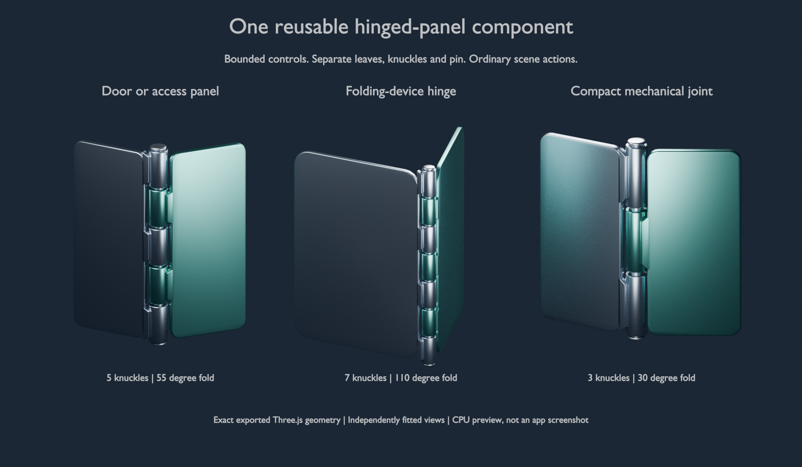
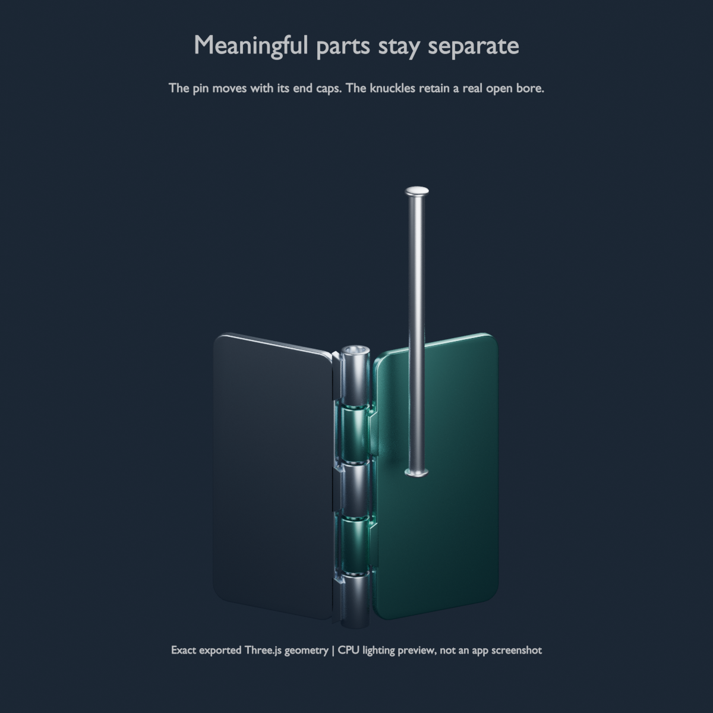
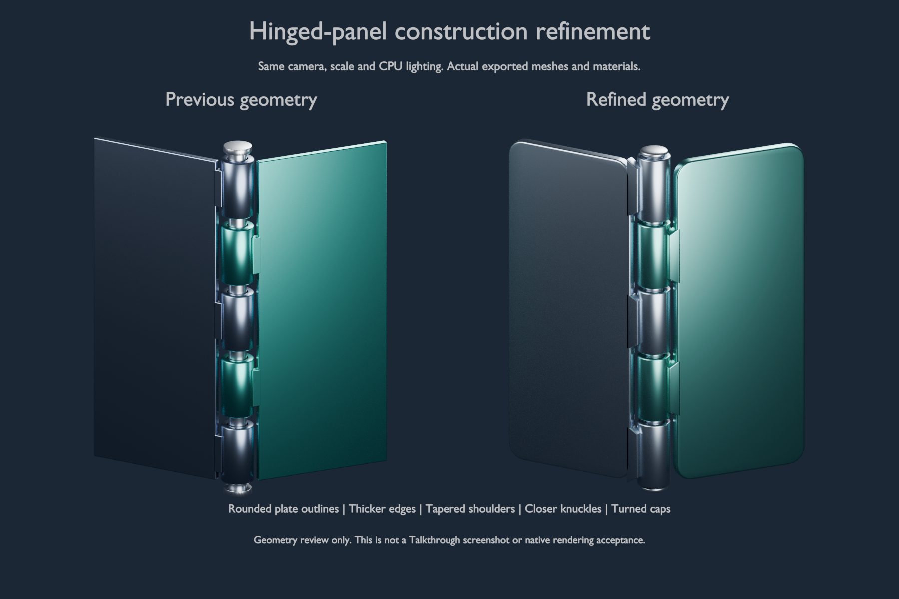

# A reusable hinged-panel component

This is an **offline authoring library component**, not a new model tool or a production scene action. One bounded TypeScript call produces normal, editable scene data for a door/access-panel hinge, a folding-device hinge or a compact mechanical joint. It depends only on public main's existing group, extrude, lathe and cylinder primitives.



The image uses actual exported Three.js geometry and normals with separate CPU lighting. It is not an Electron/WebGL screenshot. The views are independently fitted, not shown at a common physical scale.

## Use it

```ts
import { hingedPanels } from '../scripts/components/hinged-panels.ts';
import { validateScene } from '../src/scene/validate.ts';

const hinge = hingedPanels({ id: 'door', width: 2.4, height: 6, knuckles: 5, fold: 55 });
const checked = validateScene({ steps: [{ say: 'The leaves share one pin.', actions: [
  { op: 'panel', x: 100, y: 100, w: 800, h: 800 },
  { op: 'orbit', az: -25, el: 20 },
  ...hinge.actions,
] }] });
if (!checked.ok || checked.issues.length) throw new Error('Scene needs correction');
```

Parameters:

- `id`: a non-reserved scene ID prefix, 1–20 characters. Letters first, then letters, digits, underscores or hyphens.
- `width`: width of each leaf, 0.8–6 scene units; default 2.4.
- `height`: length of the knuckle stack along y, 2–12; default 5.
- `knuckles`: integer 3–7; default 5. Adjacent knuckles belong to alternate leaves.
- `fold`: 0–180 degrees about the pin's y axis; default 45. Zero lies flat and 180 folds back.

Invalid numbers, accessors, unknown options and bad prefixes throw before expansion. Thickness, barrel radius, pin clearance, knuckle spacing and chamfers are derived, not additional independent controls. Each call returns fresh arrays and profiles.

The component emits `8 + 2 × knuckles` actions: 14–22 in total, leaving room for a panel and orbit within the current 24-action step budget. Multiple assemblies still consume the normal scene action/object budgets. This is bounded expansion, not hidden renderer instancing or a reduction in the number of scene actions the renderer processes.

The caller must reserve **all generated IDs**, not only distinct root prefixes. For example, a component with prefix `h` owns `h_pin`, so another component rooted at `h_pin` would collide. The real scene validator must still check the final combined scene and follow-ups. The helper does not inspect or allocate IDs from live state.

## Meaningful parts remain addressable

`hinge.ids` contains:

- `root`, `fixed`, `moving`: assembly groups. `moving` rotates at the pin axis.
- `fixedLeaf`, `movingLeaf`: the two bevelled plates with rounded outlines.
- `knuckles[]`, `necks[]`: every hollow sleeve and its tapered shoulder connection to its leaf.
- `pin`, `pinHead`, `pinTip`: the shaft and its two turned end caps. The caps are children of the pin.

A later ordinary `turn` on `ids.moving` folds that leaf and its own knuckles/necks. An ordinary `move` on `ids.pin` carries its end caps. Each leaf, sleeve or pin can be pinned, styled or highlighted independently. Clearing the root clears its descendants; clearing the pin leaves the sleeves and their bores intact.



This is an explanatory assembly, not CAD or a manufacturing model. Necks overlap their leaves and sleeves at their junctions; they are separate meshes, not boolean-welded solids. There are no mounting holes, fasteners or certified tolerances. Tests check basic leaf clearance at intermediate folds, but do not establish continuous collision-free motion, strength or physical constraints. Follow-up actions use the existing language and can move parts beyond the helper's initial parameter bounds. The offset-pin picture is an exploded illustration, not a validated extraction path. Existing lathe cutaway/capping limitations are unchanged.

## Construction refinement



The refinement changes actual component meshes, not the app renderer or just the preview lighting:

- Leaf corners use a 24-point rounded outline with a radius independent of the edge bevel. Plate thickness increases from 0.40 to 0.65 of the barrel radius, so the edges remain readable.
- Tapered neck shoulders spread over more of each sleeve while keeping the central bore clear.
- Knuckles occupy 94% rather than 84% of their pitch. Separate lips and internal chamfers give the closer seams a construction detail without merging the parts.
- Pin caps use explicit turned profiles with a shoulder and low crown instead of tall cylindrical discs. The shaft, head and tip still have the same independent IDs and parent relationship.
- The two leaf colours are lighter for legibility; the existing metal material is unchanged. This does not add a painted, brushed or anisotropic material.

The same controls, role IDs, action count and object budget apply. The leaves and necks now use ordinary `extrude` actions instead of boxes, and the caps use `lathe` instead of cylinders. Consumers that inspect primitive shapes must handle these changes; consumers using the documented IDs for move, turn, style, highlight and clear can keep using them. Every current example fixture is regenerated from the helper.

The comparison uses one common fit from the union of both revisions' bounds, one orthographic camera and identical local light rigs linked to each revision. A single shared area-light rig would illuminate side-by-side objects differently. Sampling is also identical. No holes or fasteners have been painted onto the leaves. True mounting apertures would require a separate general geometry capability; they are not claimed here.

## Reproduce the examples and evidence

Generate four ordinary scenes, including a three-step pin-withdrawal/folding example:

```sh
node scripts/components/hinged-panels-examples.ts
node --test test/component-hinged-panels.test.ts
```

A desktop with the supported Electron runtime can play or grab those scenes normally, for example:

```sh
npm run build
npm start -- --grab samples/components/hinged-panels-door.json --steps 0:10 --out hinge-grab
```

This contribution has not established a native desktop render or live-model result. The cloud review used the real validator, timeline and `PanelScene` to build geometry, then exported each actual mesh's world-space vertices, normals, color, metalness and roughness. Blender 4.3.2 rendered those meshes using Cycles CPU with 512 samples. The image lighting and presentation are separate from the app; app labels, shadows, shaders and controls are not reproduced or accepted by these pictures.

Optional CPU preview, if Blender is already installed:

```sh
mkdir -p hinge-preview
for name in door folding joint; do
  node scripts/components/hinged-panels-preview.ts samples/components/hinged-panels-$name.json hinge-preview/$name.json
done
node scripts/components/hinged-panels-preview.ts samples/components/hinged-panels-inspect.json hinge-preview/inspect.json 1
blender -b -t 2 --python scripts/components/render-hinged-panels.py -- hinge-preview hinge-preview/gallery.png
blender -b -t 2 --python scripts/components/render-hinged-panels.py -- hinge-preview hinge-preview/detail.png detail
```

The frozen `hinged-panels-door-before.json` is the previous component's unchanged door fixture, kept only as comparison evidence. It is not regenerated by the current helper. Reproduce the controlled comparison:

```sh
mkdir -p hinge-preview/before hinge-preview/after
node scripts/components/hinged-panels-preview.ts samples/components/hinged-panels-door-before.json hinge-preview/before/door.json
node scripts/components/hinged-panels-preview.ts samples/components/hinged-panels-door.json hinge-preview/after/door.json
blender -b -t 2 --python scripts/components/render-hinged-panels.py -- hinge-preview hinge-preview/comparison.png comparison
```

The comparison mode requires Blender's light-linking support (verified on 4.3.2). The review machine's Blender has no OpenImageDenoise support, so previews use 512 CPU samples without denoising. They are geometry evidence, not final production image-quality acceptance.

The exporter is for these extrude/cylinder/lathe assemblies, not a general scene exporter. It records the source SHA-256, selected step and geometry tier; it does not export generic part-kit internals, cutaway caps, streams or text. Blender is optional and is not added as a project dependency.

## Scope and verification

No production adapter, renderer, validator, schema, prompt, model route or package dependency changed. No new model-generated code is executed. Public-main base: `bda682acd8b5fd2e0f2efef8d4caac864ecef40e`. No pending PR is required.

Fourteen focused tests cover 135 parameter combinations through unchanged real validation, malformed inputs, fresh output, ID-based follow-ups and recursive clear, real hollow geometry, basic folding transforms, 81 intermediate-angle leaf-clearance cases, finite/compact boundary meshes, reproducible scenes and the preview's mesh attribution/source hash, real rounded leaf silhouettes, tight but separate barrel seams, and a further 72 boundary/tier combinations with 12 off-axis bore rays each. Independent review additionally checked 135 low/mid/high assemblies, 48,735 half-degree leaf-volume checks and 45,360 off-axis bore rays. Those checks passed, but remain sampled regression evidence rather than certification of a physical mechanism. Review found the original fold direction caused leaf intersections and the original preview attributed meshes to parents; both have dedicated regressions observed failing before correction.

Full portable verification: 1,347 tests, 1,334 passed, 13 skipped, zero failures; typecheck, production build and whitespace checks passed. Clean public main had 1,320 passes and the same 13 skips. The existing synthetic speech-server test needs a process-only proxy exclusion for `127.0.0.2` in this cloud environment; it failed before that exclusion and passed afterward. No system or application proxy setting was changed. Native desktop checks remain among the skips.

The library does not yet integrate catalogue selection, streaming assembly admission, state-aware ID allocation, model authoring or live request measurement. The high-tier door export contains 11,716 triangles versus 16,788 in the frozen predecessor; the folding fixture contains 14,460 versus 20,652. This is a mesh-count comparison, not a speed measurement. No token savings, first-answer improvement, GPU performance or model-quality result is claimed. Those are separate integration decisions, not prerequisites for using the authored scenes or this helper offline.
