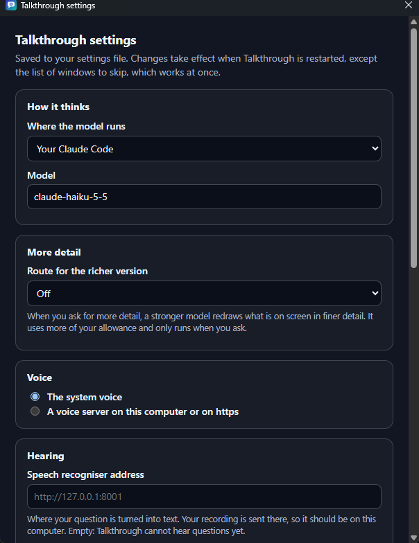
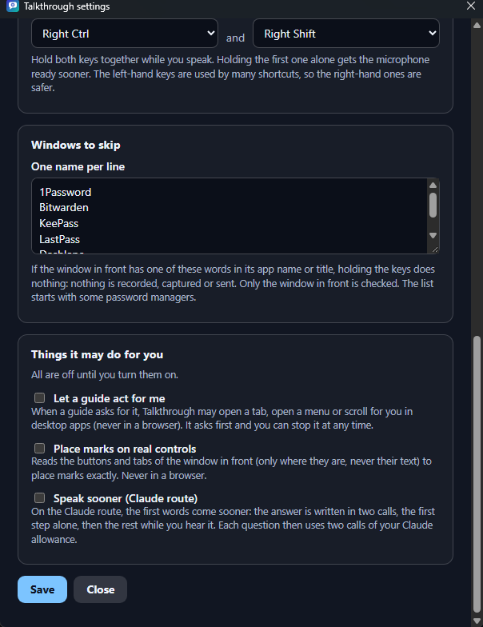
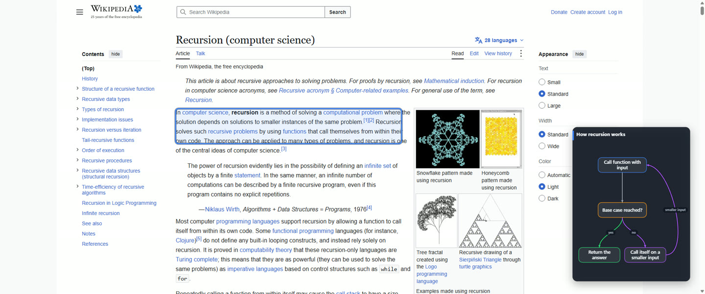
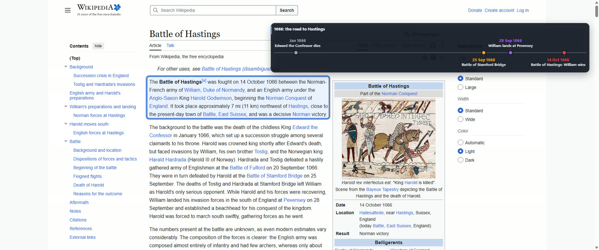
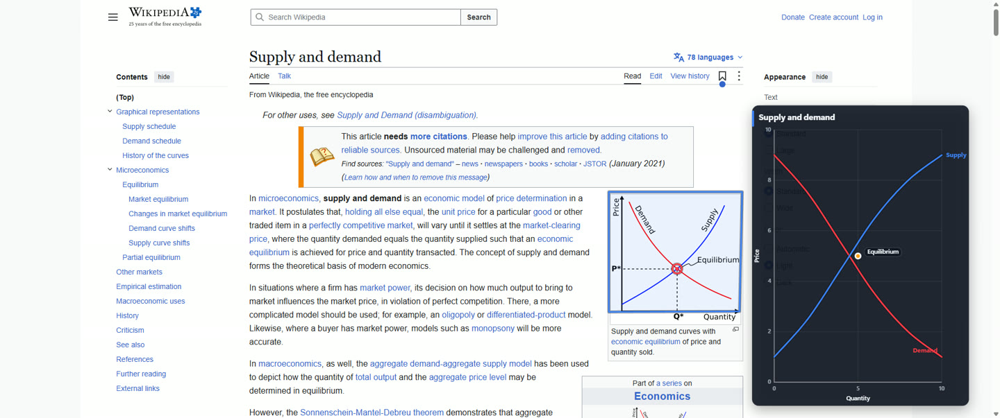
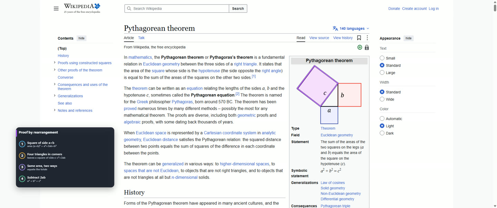
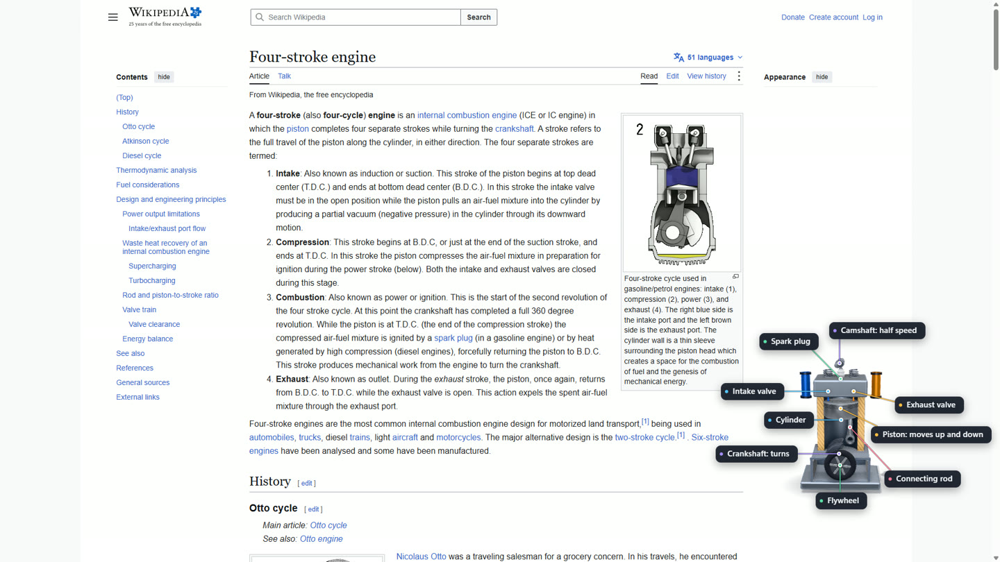
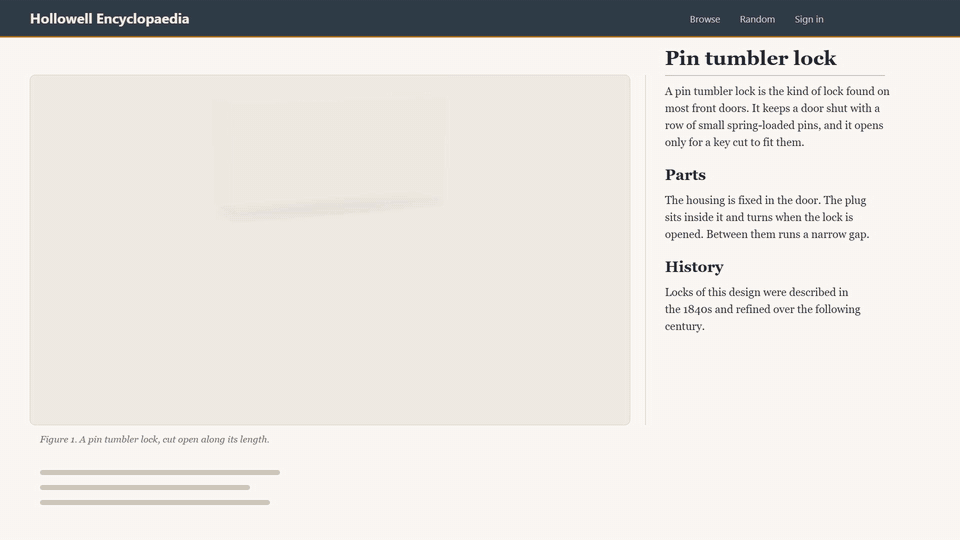
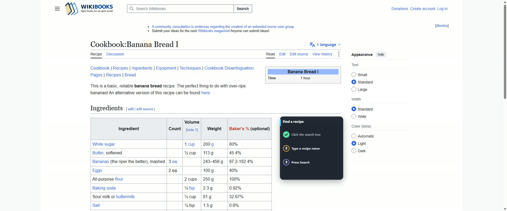

# Talkthrough 0.2.0

Release candidate. Windows 11, 64-bit, installs for your own account only (no administrator rights). The installer is not code-signed, so Windows may warn before it runs. You still need a way to hear you (a local speech recogniser) and a model of your own: see [setup](setup.md).

Every picture below is a frame of the app: the drawings are from real answers replayed over the pages they were asked about, and the two settings pictures are from this version, installed from its own installer.

## A settings window

Right-click the tray icon and choose **Settings…**. One window holds what used to need a file edit: where the model runs (your Codex, your Claude Code, or an API key) and which model, the route for the richer **More detail** version, the voice, the address of the speech recogniser, the two keys you hold to ask, the windows to skip, and three switches that are off until you turn them on.

**Windows to skip.** Put a word on a line, and when the window in front has that word in its app name or title, holding the keys does nothing: nothing is recorded, captured or sent. The list starts with some password managers. A list you save protects at once, without a restart.

**Your own keys.** Pick any two of the left or right Ctrl, Shift and Alt keys to hold.

**Speak sooner** (Claude Code route, off by default). The answer is written in two calls: the first step alone, then the rest while you hear it.

## What an answer can draw

**Diagrams that lay themselves out.** A flow for a process, a timeline for events and a chart for how two things relate. You never place the parts: they are laid out for you, drawn on as the voice reaches them, and put where the page has room. A flow whose nodes would be too small to read now grows until they can be read, gives each arrow label room of its own, and loops back inside its card.

**Marks that land on the picture.** An outline round a tilted shape, a point on one exact spot, or a line along a curve, not only a box round a region.

**3D machines.** Built part by part over the page, labelled, from a kit of ready-made parts (pistons, valves, a camshaft, gears and more). The hand-written example below shows a machine running: a key slides into a pin tumbler lock, the pins lift and the plug turns.

**Guide mode.** For "how do I do this in that app" the answer is a walk: it marks where to click, waits for your click and ticks a checklist along.

## Also in this version (no picture)

- The overlay keeps its own buttons (Explode, Cut, More detail) clear of the labels on a 3D model.
- An answer that breaks off after some steps have been drawn keeps what was drawn and ends there; it is written to the log.
- Guide mode can open a tab, open a menu or scroll for you in native windows, only if you turn it on, and the first time it asks.
- A voice can come from a text-to-speech server on your own computer; the system voice is the spare.

## Known limits

- It needs a speech recogniser you point it at (see [setup](setup.md)).
- Windows only.
- Page content in the pictures is from Wikipedia and Wikibooks (CC BY-SA 4.0), shown for illustration.
